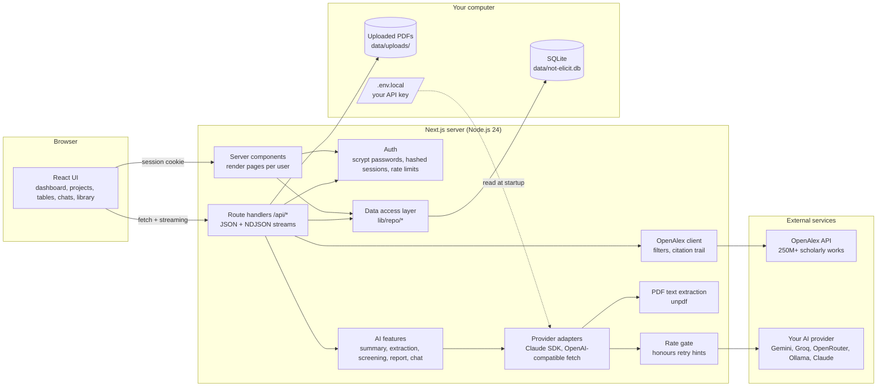
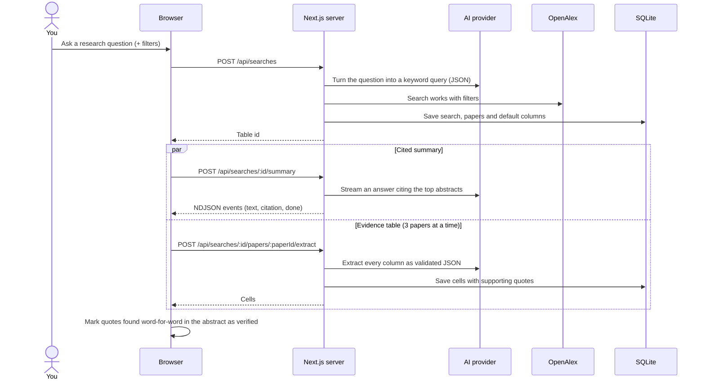
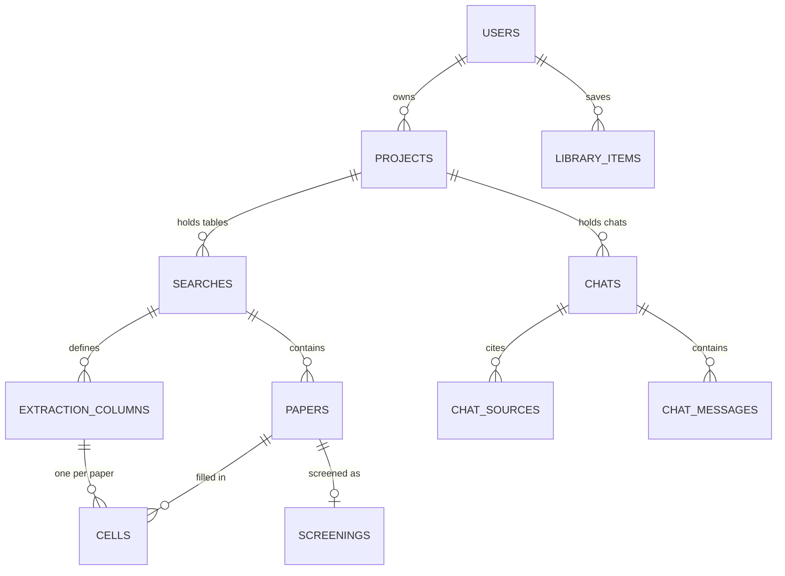

# Not-Elicit.ai

An open-source AI research assistant for literature reviews. Ask a research question and get a cited answer from academic papers, a table of evidence extracted from every study, and tools to screen, report on, and chat with the literature.

Run it on your own computer with **your own API key**. Free options include Google Gemini, Groq, OpenRouter, and local models through Ollama. Claude is also supported.

> Not-Elicit.ai is an independent open-source project inspired by tools like Elicit. It is not affiliated with, endorsed by, or connected to Elicit or Ought, and it contains none of their code.

## Features

**Find and read papers**

- **Search:** your question is turned into a keyword query over 250M+ scholarly works in [OpenAlex](https://openalex.org). You can filter by year range, minimum citations, open access only, and publication type.
- **Cited summary:** a short answer from the top papers' abstracts. Every claim links to the paper it came from.
- **Evidence table:** study design, population, main findings and limitations are extracted from each paper, each with a verbatim supporting quote. Quotes found word-for-word in the abstract are marked **verified**. You can add your own columns (dosage, effect size, country, …), and sort and filter the rows.
- **Citation trail:** from any paper, add related papers, papers that cite it, or its references to the table.
- **Your PDFs:** uploaded papers join the table and are read in full text.

**Review and write**

- **Screening:** for systematic reviews, write inclusion criteria and the AI marks each paper *Include*, *Maybe* or *Exclude*, with a note per criterion. You can override any decision.
- **Research report:** a structured literature review (overview, key findings, evidence quality, disagreements, gaps) with citations. It is built from the table and uses only screened-in papers when you screen.
- **Chat:**
  - The *research assistant* finds papers for every question and answers with citations, remembering the conversation.
  - *Chat with papers* answers only from papers you pick from a table or your library, including their full text.

**Organise**

- **Projects:** folders that hold your tables and chats.
- **Library:** save papers from any table with ☆, upload PDFs, tag and annotate them, and import from Zotero, Mendeley or EndNote (BibTeX/RIS). Select papers to build a table or start a chat.
- **Export:** tables to CSV; papers and your library to BibTeX or RIS.

## Install and run

You need [Node.js 24 or newer](https://nodejs.org) (it includes the built-in SQLite driver this app uses) and [Git](https://git-scm.com).

```bash
git clone https://github.com/MD-ATIF-ALI-KHAN/Not-Elicit.ai.git
cd Not-Elicit.ai
npm install
npm run setup     # choose an AI provider and paste your API key
npm run dev       # then open http://localhost:3000
```

`npm run setup` asks which AI provider you want and for your API key. It saves them to a file called `.env.local` in the project folder.

- That file stays on your computer. Git ignores it, so your key is never committed or shared.
- The key is only used to talk to the AI provider you chose.

To set things up by hand instead, copy `.env.example` to `.env.local` and fill in one key.

Then create an account in the app (it's stored locally) and ask your first question.

### Choose an AI provider

You need **one** of these. The app picks it up automatically.

| Provider | Cost | Put in `.env.local` | Get a key |
|---|---|---|---|
| Google Gemini | free tier | `GEMINI_API_KEY=...` (default model `gemini-3.5-flash-lite`, about 15 requests/min free) | <https://aistudio.google.com/apikey> |
| Groq | free tier | `GROQ_API_KEY=...` (default model `llama-3.3-70b-versatile`) | <https://console.groq.com/keys> |
| OpenRouter | free models | `OPENROUTER_API_KEY=...` and `AI_MODEL=` a model ending in `:free` | <https://openrouter.ai/keys> |
| Ollama | free, runs on your PC | `AI_PROVIDER=ollama` and `AI_MODEL=llama3.1` | <https://ollama.com> |
| Any OpenAI-compatible server | varies | `AI_PROVIDER=openai-compatible`, `AI_BASE_URL`, `AI_MODEL`, optional `AI_API_KEY` | — |
| Anthropic Claude | paid | `ANTHROPIC_API_KEY=...` (default `claude-opus-5-5`) | <https://platform.claude.com/settings/keys> |

- `AI_MODEL` overrides any provider's default model.
- Restart the server after editing `.env.local`.
- The model in use is shown at the bottom of each table and chat.

Free tiers have rate limits. When the provider says "slow down", the app pauses all requests for as long as it asks, then continues. Any cell that still fails gets a **Retry** link. You can also pace requests ahead of time with `AI_REQUESTS_PER_MINUTE`.

Search works without any AI key; it uses your question as the query. The summary, table, screening, report, chat and PDF reading need a provider.

### Other settings

| Variable | Purpose |
|---|---|
| `OPENALEX_API_KEY` | Recommended. Free key from <https://openalex.org/settings/api>. Without one, searches share a small anonymous daily budget. |
| `OPENALEX_MAILTO` | Contact email sent to OpenAlex |
| `AI_MAX_PDF_CHARS` | Characters of PDF text sent to non-Claude models (default 60000) |
| `AI_REQUESTS_PER_MINUTE` | Optional cap on AI requests per minute |
| `DISABLE_SIGNUPS` | `true` closes registration once your own account exists |
| `NOT_ELICIT_DATA_DIR` | Where the SQLite database and PDFs live (default `./data`) |

## Security and privacy

- **Your API key** lives only in `.env.local` on your machine. It's never stored in the database, shown in the app, or sent anywhere except to the AI provider you configured. Never commit `.env.local`.
- **Your data** (accounts, projects, uploaded PDFs) stays in the local `data/` folder. Paper text you analyse is sent to your AI provider, and searches go to OpenAlex.
- **Accounts:**
  - Passwords are hashed with scrypt.
  - Sessions are random tokens stored hashed, in an httpOnly, SameSite=Lax cookie.
  - Log-in and sign-up attempts are rate limited.
- **Requests:**
  - API routes reject cross-origin writes.
  - Every database query is scoped to the signed-in user.
  - Links from imported data are restricted to http(s).
  - Uploads are size-checked before being read.
  - Responses send anti-framing and no-sniff headers.

**Hosting it for other people?**

- Put it behind HTTPS. Session cookies are marked `Secure` in production.
- Set `DISABLE_SIGNUPS=true` once your account exists, because everyone who can sign up uses *your* API key.
- Remember that each server process keeps its own rate-limit counters.

Found a vulnerability? Please open a private security advisory on GitHub instead of a public issue.

## How this project was built

### Where REA fits in

This project started in a [Claude Code](https://claude.com/claude-code) session with **[REA (Reverse Engineer Anything)](https://github.com/morluto/rea)** loaded. REA is an open-source toolkit that lets AI agents analyse software you can download: native binaries, managed assemblies, Android APKs, Electron/JavaScript bundles, firmware, WebAssembly, packet captures and more. It records evidence for every conclusion.

The first request was to "reverse engineer elicit.com". REA turned out to be the wrong tool for that, and the reason shaped the whole project:

- **There was nothing to reverse engineer.** Elicit is a hosted web service, so its code runs on Elicit's servers, not on your computer. REA's analysis tools need a local artifact (an installer, binary, APK, bundle or capture). Without one, REA's own guidance is not to guess.
- **Copying wasn't the goal.** Re-creating another company's code or design and putting a new name on it would infringe their copyright and trademark.

So **no REA analysis was ever run against Elicit**, and this repository contains none of Elicit's code, design or assets. It is a **clean-room implementation**: built from scratch from a list of features, the kind of thing anyone can see on a product's public website. Credit to REA for kicking off the project and for its principle of only claiming what the evidence supports.

### How it was built

1. **Feature study:** list what an AI research assistant like this does from public information (search papers, cited summary, extraction table, PDF upload, screening, reports, chat, library).
2. **Original design:** choose an open data source ([OpenAlex](https://openalex.org)), a local-first stack (Next.js + SQLite) and a provider-agnostic AI layer, then design the data model, API and UI from scratch.
3. **Build in vertical slices:** search → summary → table → PDFs → projects, library, screening, reports and chat. Each slice came with unit and route-level tests.
4. **Free-model support:** abstract the AI layer so the same features run on free APIs (Gemini, Groq, OpenRouter) or local models. Citations, structured output and PDF reading are re-implemented where those models lack Claude's native features.
5. **Verify with real models:** run every feature end to end in a real browser against live Gemini. This found and fixed real bugs:
   - the OpenAlex wildcard error on questions ending in "?"
   - free-tier rate limits (fixed by reading the provider's retry hints)
   - BibTeX imports losing their first entry after a `@comment`
   - LaTeX symbols leaking into answers
6. **Harden before publishing:** a security review added log-in rate limiting, http(s)-only links, upload size checks, security headers and an optional sign-up lock. A secret scan of every file and commit confirmed no API keys are published.

## Architecture

Not-Elicit.ai is a single Next.js application that runs on your machine. The browser talks only to your local server. The server talks to two outside services: **OpenAlex** for papers, and **the AI provider you chose** for reading and writing. Everything you create is stored locally in SQLite.

### System overview



### What happens when you ask a question



### Data model



A *search* is one table: either a question searched on OpenAlex, or papers you picked from your library. Chats keep their own copy of each source, including text extracted from PDFs, so deleting a table never breaks a conversation.

### Layers

- **UI (`src/app`, `src/components`):**
  - Server components load data for the signed-in user.
  - Client components handle the interactive parts: the table, streaming answers, the chat and the library.
  - `CitedText` renders Markdown answers with clickable citation numbers.
- **API (`src/app/api`):**
  - Every route checks the session and same-origin requests, validates input with Zod, and loads only data the user owns.
  - Long answers stream as newline-delimited JSON events.
- **Data (`src/lib/db.ts`, `src/lib/repo`):**
  - One SQLite file with versioned migrations that run on start.
  - All queries are parameterised and scoped to the user.
- **AI (`src/lib/ai`):**
  - Every provider offers two building blocks (`provider.ts`): *stream an answer that cites these sources*, and *return JSON matching this schema*.
  - Every feature (summary, extraction, screening, report, chat, PDF reading) is written once on top of them (`features.ts`).
  - **Claude** (`claude.ts`): the Anthropic SDK, with native search-result citations, structured outputs, PDFs as cached document blocks, and server-side refusal fallbacks.
  - **Everything else** (`openai-compatible.ts`): plain `fetch` against the OpenAI-compatible Chat Completions API.
    - Answers stream with `[n]` markers, which `citations.ts` turns into the same citation events Claude produces.
    - JSON output is validated against Zod schemas, with one retry if it's invalid.
    - PDFs are converted to text locally.
    - A shared rate gate (`rate-gate.ts`) pauses every request when the provider says to slow down.
- **Papers (`src/lib/openalex.ts`):** search with filters, plus related, citing and referenced works for the citation trail.

### Code layout

```
src/
  app/
    page.tsx                  landing page
    (auth)/                   sign up / log in (server actions)
    (app)/dashboard/          projects and recent tables
    (app)/projects/[id]/      one project: its tables and chats
    (app)/searches/[id]/      table workspace: summary, report, screening, evidence table
    (app)/chats/[id]/         chat with cited sources
    (app)/library/            saved papers, import/export
    api/...                   JSON + streaming route handlers
  components/                 shared UI (cited-text renderer, dialogs, forms)
  lib/                        db + migrations, auth, OpenAlex client, formats (CSV/BibTeX/RIS)
  lib/repo/                   data access: projects, searches, library, chats
  lib/ai/                     AI providers, features, prompts, citation parser, rate limiting
scripts/setup.mjs             interactive .env.local setup
tests/                        Vitest suites (AI providers and OpenAlex are faked)
```

## Development

| Command | What it does |
|---|---|
| `npm run setup` | Interactive setup for `.env.local` |
| `npm run dev` | Development server |
| `npm run build` / `npm start` | Production build and server |
| `npm test` | Unit and route-handler integration tests (Vitest) |
| `npm run typecheck` | TypeScript check |
| `npm run lint` | ESLint |

The tests run every route handler against a real in-memory SQLite database, with the AI provider and OpenAlex replaced by fakes, so they need no API keys or network.

## Limits

- The summary reads up to 10 top papers and the report up to 20, using abstracts (or the abstract the AI pulls from an uploaded PDF).
- Table cells for search results come from abstracts, not full text. Upload the PDF for full-text extraction.
- PDF uploads are limited to 20 MB. With non-Claude models, scanned PDFs (images with no selectable text) can't be read, and very long papers are cut to `AI_MAX_PDF_CHARS`.
- Result quality depends on the model. Small or free models write weaker summaries and extract less precisely than larger ones.
- AI can make mistakes. Check the supporting quotes and the papers themselves.

## License

[MIT](LICENSE) © 2026 MD Atif Ali Khan
